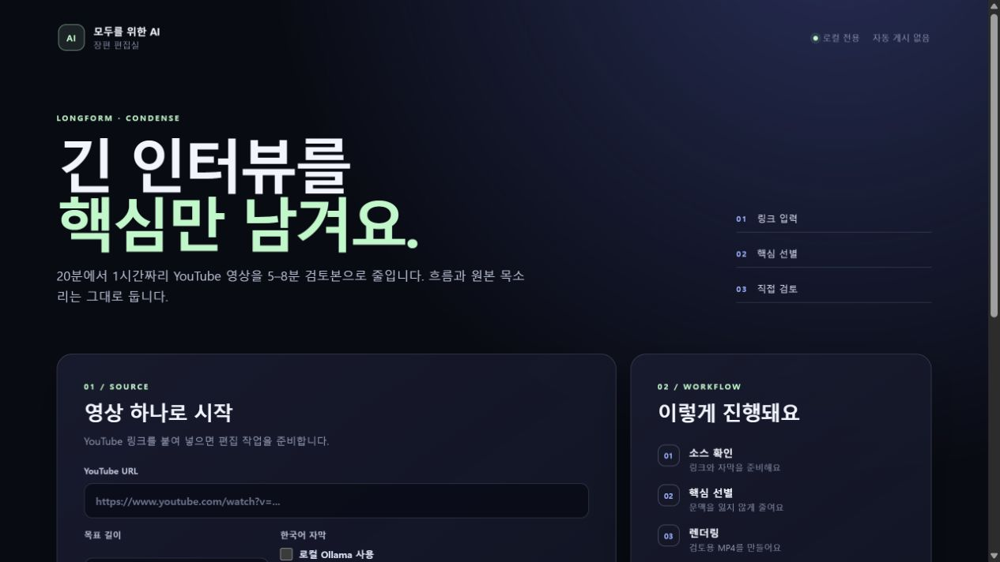

<!-- JUWON-PORTFOLIO-INTRO:START -->
# 모두를 위한 AI 장편 편집실



*Recorded local editor start screen. Download, translation, and rendering jobs were not exercised for this capture.*

*로컬 장편 편집실 시작 화면 · 다운로드·번역·렌더 작업은 실행하지 않음*

## English

A local long-form editing prototype intended to condense English interviews and videos into coherent 5–8 minute edits, with queue visibility, model selection, and permission notes.

[View JUWON's portfolio](https://jupt.pages.dev/) · [Browse the project collection](https://jupt.pages.dev/projects)

**Scope:** This README presents the repository's documented intent and recorded visual evidence. It does not certify that every feature is complete, deployed, or currently working. Follow the original setup, safety, and license documentation below.

This repository is a selected original-source snapshot. The recorded source fingerprint describes the initial publication; this portfolio introduction was added afterward. Original technical documentation is preserved below.

## 한국어

영어 장편을 5~8분으로 줄이는 편집실. 대기열·모델 선택·개인 허가 메모를 포함합니다.

[JUWON 포트폴리오 보기](https://jupt.pages.dev/) · [전체 프로젝트 보기](https://jupt.pages.dev/projects)

**확인 범위:** 저장소의 문서상 목적과 기록된 화면 근거를 소개합니다. 모든 기능의 완성·배포·현재 정상 작동을 보증하지 않습니다. 설치법·안전 주의사항·라이선스는 아래 기존 문서를 확인하세요.

선택된 원본 소스의 공개 스냅샷입니다. 기록된 소스 지문은 최초 공개 시점을 나타내며, 이 포트폴리오 소개는 이후 추가했습니다. 기존 기술 문서는 아래에 보존했습니다.
<!-- JUWON-PORTFOLIO-INTRO:END -->

---

## Original documentation / 기존 문서

# Juwon AI Video Editor

승인된 대본, 직접 촬영한 얼굴 영상, 화면 녹화, 출처가 연결된 이미지로 검토용 영상을 만든다. YouTube 업로드 기능은 없다. `approved`도 로컬 승인 기록일 뿐 게시를 뜻하지 않는다.

## 요구 환경

- Node.js 22 이상
- FFmpeg 및 ffprobe 7 이상
- Google Chrome 또는 Microsoft Edge
- (기존 facecam 모드) OpenAI transcription API 및 NVIDIA NIM 접근 권한
- (장편 모드) 직접 제공하는 영어 transcript 또는 연결한 transcription provider

확인:

```powershell
node --version
ffmpeg -version
ffprobe -version
```

API 키는 Company OS의 서버 전용 credential 저장소 또는 운영체제의 비밀 관리 기능으로 설정한다. 키 값을 대본, `sources.json`, job 파일, 로그, 명령 기록, Git에 넣지 않는다.

## 입력 구조

모든 job은 설정된 `JUWON_VIDEO_JOBS_ROOT` 안에 둔다.

```text
video_example_001/
  input/
    script.md
    sources.json
    facecam/
      main.mp4
    screen/
      demo.mp4
    assets/
      source-image.png
    music/
      optional-track.m4a
```

`sources.json`:

```json
{
  "version": 1,
  "sources": [
    {
      "id": "source_openai",
      "title": "Official product announcement",
      "url": "https://example.com/article",
      "publisher": "Example",
      "publishedAt": "2026-07-23",
      "usage": "commentary-screenshot",
      "localAsset": "assets/source-image.png"
    }
  ],
  "screenClips": [
    {
      "id": "screen_demo",
      "path": "screen/demo.mp4",
      "description": "제품을 직접 사용하는 화면",
      "scriptHints": ["직접 사용", "데모"]
    }
  ]
}
```

절대 경로, `..`, job 밖으로 나가는 symlink는 거부된다. 원본 입력은 수정하지 않는다.

## 장편 핵심 유지 압축 모드

20–60분 영어 인터뷰를 원본 순서와 문맥을 유지한 5–8분 가로 영상으로 만든다. 문장 중간을 자르지 않고, 선택된 구간의 원본 영상과 오디오를 그대로 사용한다. Shorts/세로 출력과 자동 업로드는 없다.

```text
video_longform_001/
  input/
    source/
      main.mp4
      transcript.en.json       (선택: 없으면 provider 필요)
      korean-words.json        (선택: source timestamp 기준)
    sources.json               (권리·출처 메타데이터, 없으면 review warning)
  work/
  output/
```

영어 transcript 최소 예시:

```json
{
  "version": 1,
  "language": "en",
  "durationSeconds": 1200,
  "segments": [
    {
      "id": "segment_001",
      "start": 0,
      "end": 4.2,
      "text": "A complete thought.",
      "speaker": "guest",
      "words": [{ "word": "A", "start": 0, "end": 0.3 }]
    }
  ]
}
```

실행:

```powershell
node src\cli.mjs run --mode longform-condense `
  --job-dir <job-path> --job-id video_longform_001 `
  --target-duration 390 `
  --transcript <job-path>\input\source\transcript.en.json `
  --korean-words <job-path>\input\source\korean-words.json
```

YouTube 영상은 URL만 넘기면 `yt-dlp`가 단일 영상을 MP4로 내려받아 `input/source/main.mp4`에 넣은 뒤 같은 압축 루트를 실행한다. 영어 수동/자동 자막도 함께 요청해 가능하면 `input/source/transcript.en.json`으로 변환한다. 자막 요청이 429이거나 영상에 자막이 없으면 MP4는 보존하고 transcript 검토 대기로 남긴다. 재생목록은 받지 않으며, 권리 상태는 자동으로 `unknown`으로 기록해 사람 검토를 요구한다.

웹 편집실에서 **개인 이메일로 사용 허가를 받은 영상**을 선택하면 `sources.json`과 작업 매니페스트에 `licensed` 및 `personal-email` 메타데이터가 기록된다. 이메일 원문은 저장·업로드하지 않고, 사용자가 입력한 짧은 메모만 남긴다. 이 선택은 권리 검토 기록을 위한 것이며 경로 안전 검사와 최종 사람 검토를 건너뛰지 않는다. CLI에서는 `--personal-permission --permission-note "허가 메일 확인"`을 사용할 수 있다.

```powershell
node src\cli.mjs run --mode longform-condense `
  --job-dir <job-path> --job-id video_longform_001 `
  --youtube-url "https://www.youtube.com/watch?v=<video-id>" `
  --target-duration 390 `
  --transcript <job-path>\input\source\transcript.en.json `
  --korean-words <job-path>\input\source\korean-words.json
```

이 경로는 `yt-dlp`와 `ffmpeg`가 필요하다. `yt-dlp` 실행 파일을 먼저 찾고, 없으면 `python -m yt_dlp`, `py -3 -m yt_dlp` 순서로 시도한다. 다른 실행 파일을 쓰려면 `--yt-dlp-path <path>` 또는 `YT_DLP_PATH`를 지정한다. 같은 URL과 같은 `main.mp4`가 있으면 재다운로드하지 않는다. 다시 받으려면 `--force-source-download true`를 사용한다. YouTube URL에서 영어 transcript를 자동 생성하려면 명시적으로 `--transcriber openai`를 추가해야 하며, 유료 API 호출이다.

`--target-duration`는 300–480초만 허용한다(기본 390초). `korean-words.json`을 생략하면 영상은 `KOREAN_SUBTITLES_REVIEW_REQUIRED` 경고와 함께 영어 원본 오디오로 검토본을 만든다. 번역 provider를 연결하면 선택된 source 구간만 번역한다.

transcript 파일이 없을 때만 명시적으로 `--transcriber openai`를 추가하면 OpenAI `whisper-1` 영어 word/segment timestamp adapter를 사용한다. 이 경로는 유료 API 호출이므로 기본값이 아니다. 로컬 transcript/provider가 있으면 그 경로가 우선이다.

로컬 Ollama가 실행 중이고 Korean 자막을 만들려면 `--translator ollama`를 추가한다. 기본 endpoint는 `http://127.0.0.1:11434/api/chat`이며, 필요하면 `--ollama-url`과 `--ollama-model`로 바꾼다. Ollama 연결·응답이 실패하면 자막을 만든 척하지 않고 `KOREAN_SUBTITLES_PROVIDER_FAILED` 검토 경고를 남긴다.

장편 검토본에는 다음이 추가된다:

```text
output/v001/
  preview.mp4
  korean-subtitles.srt
  condense-plan.json
  chapters.md
  source-citations.json
  warnings.json
  render-manifest.json
```

`preview.mp4`를 사람이 확인한 뒤에만 `approve`를 실행한다. 승인도 로컬 상태 기록이며 YouTube 게시를 수행하지 않는다.

## 실행

`video-editor` 폴더에서:

```powershell
node src\cli.mjs run --job-dir <job-path> --job-id video_example_001
node src\cli.mjs status --job-dir <job-path>
node src\cli.mjs revise --job-dir <job-path> --from matching --note "실제 화면 녹화 사용"
node src\cli.mjs approve --job-dir <job-path> --version v001 --output-sha256 <sha256>
```

결과:

```text
output/v001/
  preview.mp4
  edit-report.json
  source-list.md
  warnings.json
  render-manifest.json
```

기존 `v001`은 덮어쓰지 않는다.

## 상태

- `queued`: 생성됨
- `validating`: 입력 검사
- `transcribing`: source transcript/word timestamp 생성
- `planning`: 편집안 생성
- `matching`: 허용된 asset 연결
- `rendering`: Remotion 및 FFmpeg 렌더
- `checking`: 해상도, fps, 음량, 출처, 화면 안전성 QA
- `ready-for-review`: 사람이 볼 수 있음. 승인 아님
- `revision-requested`: 지정 단계부터 다시 작업 필요
- `approved`: 해당 로컬 파일 hash 승인. 업로드 안 함
- `blocked`: 입력, credential, provider, 렌더 또는 QA 문제

`DEGRADED_EDIT_PLAN`은 NIM 계획을 신뢰할 수 없어 얼굴 전체 화면 중심의 보수적 편집안을 사용했다는 뜻이다.

## blocked 복구

1. `status`와 `work/job-state.json`의 상태 코드 확인.
2. 누락 입력, 잘못된 출처, API 접근, FFmpeg/Chrome 설치 문제 해결.
3. 완성된 검토본의 수정이면 `revise --from ...` 사용.
4. 같은 job을 다시 `run`. 원본 영상은 그대로 보존된다.

## 출처와 저작권

- 직접 촬영한 영상, 실제 화면 녹화, 사용 허가된 공식 미디어만 사용한다.
- 기사 이미지는 `sources.json`의 URL과 local asset을 함께 기록한다.
- 매칭 신뢰도가 낮으면 관련 없는 이미지를 넣지 않고 `face-full`로 돌아간다.
- 자동 편집 결과는 게시 전 사람이 사실, 저작권, 자막, 화면 노출을 검토한다.
